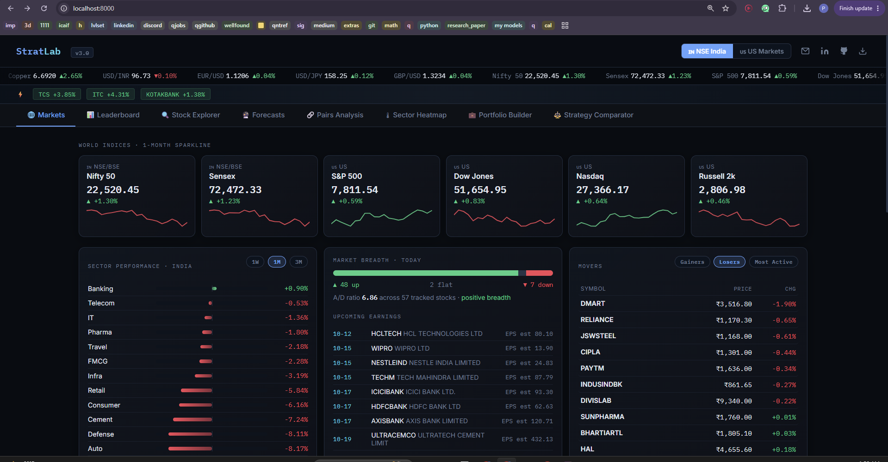

# Kairos

A multi-strategy backtesting and market research platform for Indian (NSE) and US equities, with a C++ backtest core exposed to Python through pybind11.



## What it does

| Tab | What you get |
|---|---|
| **Markets** | Live index cards with sparklines, sector performance (1W/1M/3M), market breadth, top gainers/losers/most active, upcoming earnings, India vs US macro snapshot, commodities, FX and crypto |
| **Leaderboard** | Six strategies ranked by Sharpe, with equity curves and trade logs |
| **Strategy Lab** | Backtest any stock with any of six strategies and your own parameters, trading costs, long/short, and an in-sample vs out-of-sample split. Includes a parameter heatmap to spot overfitting and a live engine benchmark |
| **Stock Explorer** | Line or candlestick charts, SMA, Bollinger Bands, anchored VWAP, RSI or MACD, a statistical forecast cone, compare mode (up to 5 stocks), analyst targets, options open interest with put/call ratio and max pain (US) |
| **Screener** | 60 stocks per market with RSI, trend, 52-week position, volatility, P/E and market cap. Presets, filters, sorting, CSV export |
| **Forecasts** | Quarter-end projections with Gaussian, split-conformal and regime-conditional conformal 80% bands, plus an out-of-sample coverage check |
| **Pairs Analysis** | Engle-Granger cointegration, hedge ratio, half-life of mean reversion, live z-score signal and a full pairs backtest |
| **Sector Heatmap** | Returns by sector and stock |
| **Portfolio Builder** | Simulation, efficient frontier, max-Sharpe, min-variance and risk-parity weights, VaR/CVaR, beta, correlation matrix |
| **Paper Trading** | Virtual ₹10 lakh and $100k accounts, market orders at live prices, positions, P&L, watchlist and price alerts with desktop notifications |

Press **Ctrl+K** anywhere to jump to any stock, tab or action.

## Quant methods

- **No look-ahead.** A signal computed at the close of day *t* is traded on day *t+1*. Costs are charged in basis points on every change in position.
- **Overfitting check.** Every backtest reports full, in-sample and out-of-sample metrics. The parameter heatmap shows in-sample and out-of-sample Sharpe side by side, so a single bright cell that collapses out-of-sample is easy to spot.
- **Cointegration.** OLS hedge ratio on log prices, ADF test on the residual spread (MacKinnon 2010 critical values, or exact p-values via statsmodels), and half-life from an AR(1) fit of the spread.
- **Portfolio optimisation.** Long-only max Sharpe (projected gradient ascent on the simplex), minimum variance, risk parity (equal risk contribution) and an efficient frontier, all in NumPy. Historical and parametric 1-day VaR/CVaR at 95%.
- **Conformal forecast bands.** Forecast errors are normalised by trailing volatility and the 80% band is sized from the empirical quantile of past errors (split conformal). The regime-conditional variant calibrates separate quantiles for high and low volatility regimes. Coverage is measured on the most recent 40% of forecast dates. In simulation the conformal band averages about 79% coverage at a 244-day horizon, against about 72% for the Gaussian band.

## C++ engine

`cpp/fastbt.cpp` implements the position backtest and the moving-average parameter sweep in C++17, releases the GIL during computation, and matches the NumPy implementation to about 1e-15 in Sharpe. If it is not built, everything falls back to NumPy automatically.

Benchmark on the same 25 × 47 parameter grid (1,117 backtests, 1,260 daily bars), measured on a cloud Linux VM:

| Engine | Backtests / second | Speedup |
|---|---|---|
| Pure Python | ~2,050 | 1× |
| NumPy | ~20,000 | ~10× |
| C++ (pybind11) | ~252,000 | ~123× |

Run it yourself from the Strategy Lab tab.

## Run locally

```bash
pip install -r requirements-deploy.txt
./build_cpp.sh          # optional, builds the C++ engine
python3 main.py         # run the strategy backtests
python3 main.py serve   # open http://localhost:8000
```

On Ubuntu/WSL the C++ build needs `sudo apt install -y g++ python3-dev`.

## Deploy

The repo includes a `Dockerfile` and a Render blueprint (`render.yaml`). Push to GitHub, then in Render choose **New → Blueprint** and select the repo. The free tier sleeps after inactivity, and paper-trading data resets on each redeploy.

## Stack

Python, FastAPI, NumPy, pandas, yfinance, SQLite, C++17 with pybind11, and a dependency-free JavaScript/SVG frontend.

Market data comes from Yahoo Finance and can be delayed. Projections are statistical baselines, not investment advice.

## Author

**Poorvi Patil** · MS Machine Learning Engineering, Drexel University
[LinkedIn](https://linkedin.com/in/poorvi-patil-216391170) · [GitHub](https://github.com/poorvipatil21) · poorvipatil2115@gmail.com
